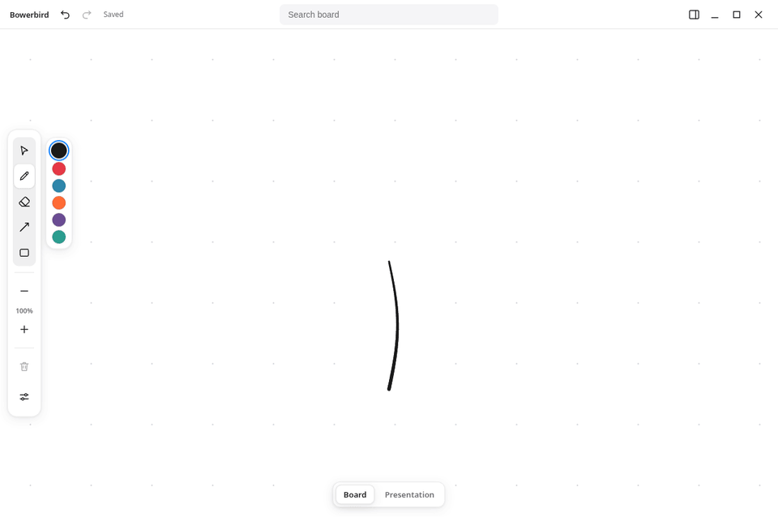
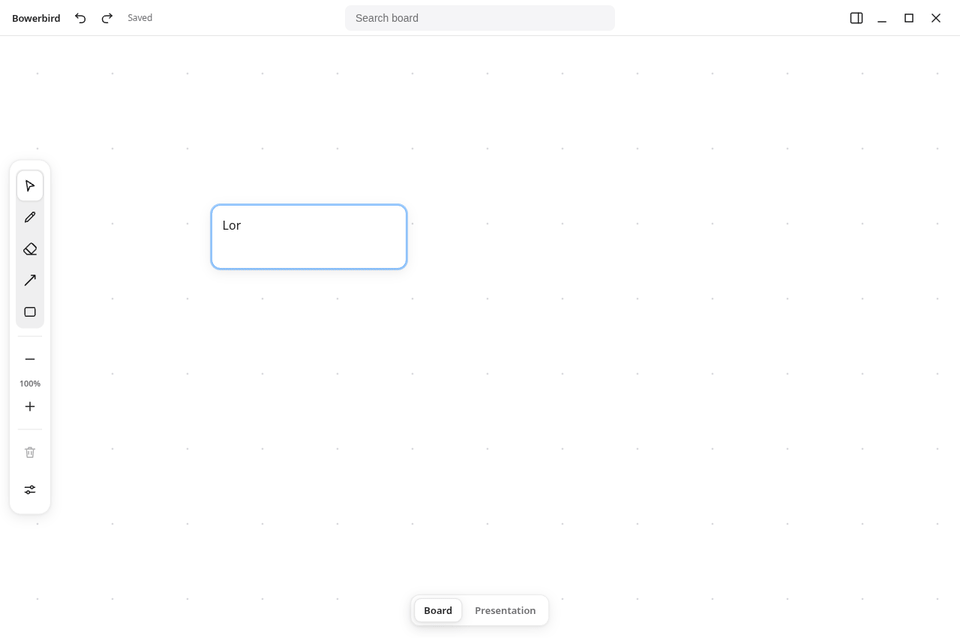
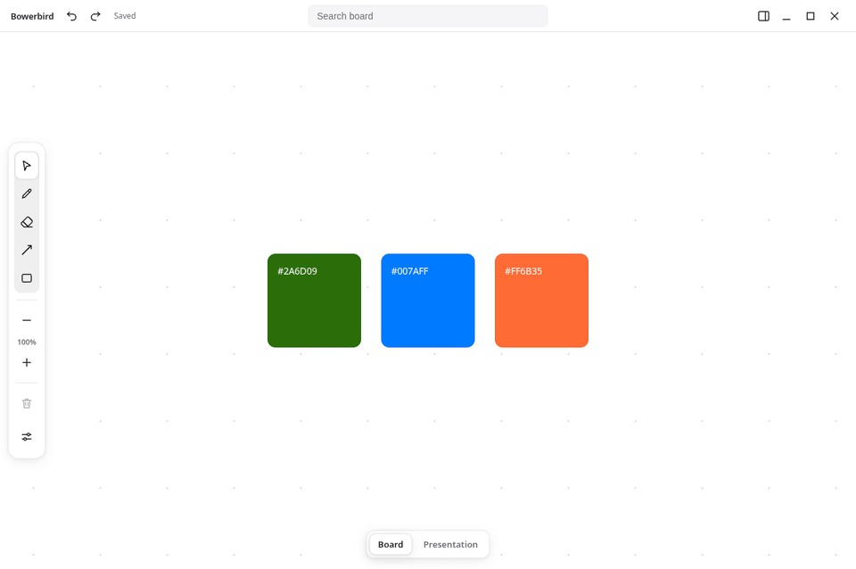
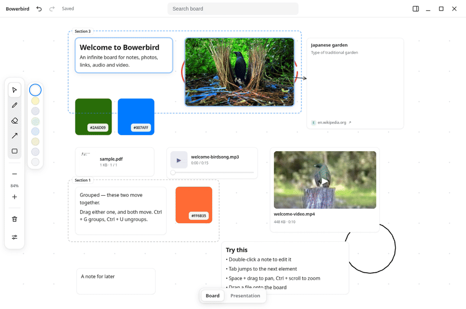
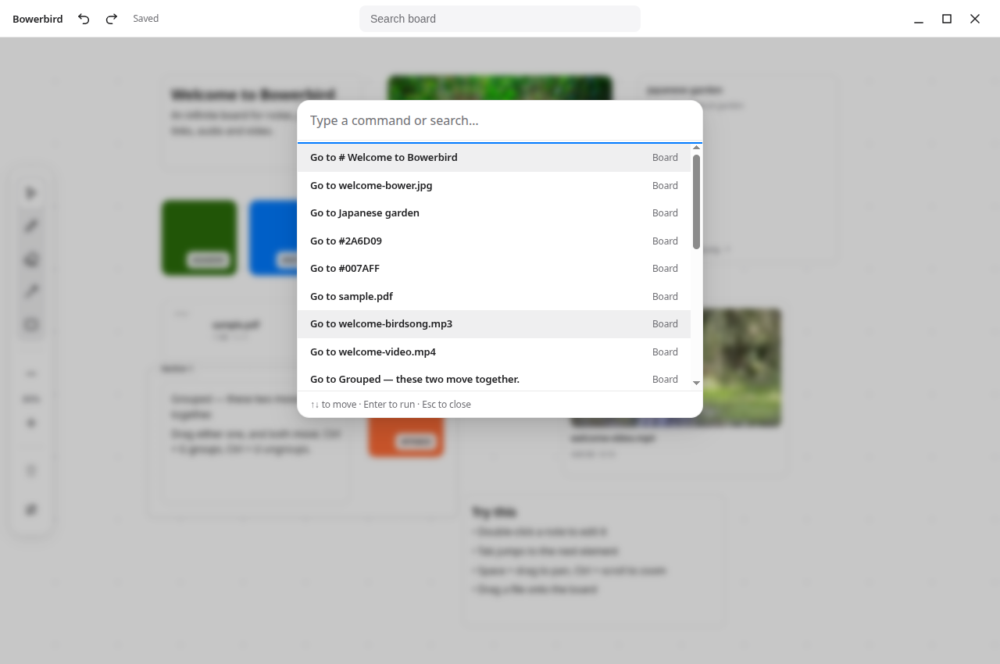
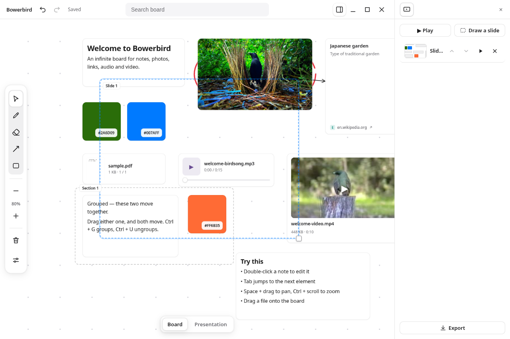

# Bowerbird

An infinite whiteboard for creatives. One window, always there, ready to drop things onto.

Drop images, notes, links, PDFs, audio, video and colours onto the board. Pan and zoom freely, sketch with a pen, connect things with lines, draw shapes, rotate cards and strokes, and group items that belong together. The board saves on every change, and backs itself up at most once an hour.

Link cards are previews only. They do not embed web pages.

## What it looks like


The board. Notes, photos, links, audio, video and colour cards on an infinite canvas.



Sketch with the pen.



Double-click anywhere to add a note.



Select cards and group them with Ctrl+G. They move together.



Space + drag to pan, = to zoom in.



Ctrl+K opens the command palette. It lists every action and jumps to any card.



Draw a slide over part of the board and present it.

## Run it

```sh
npm install
npm run dev
```

## Package it

```sh
./scripts/package-mac.sh      # macOS DMG
./scripts/package-win.sh      # Windows zip
./scripts/package-linux.sh    # Linux tarball
```

Or push a version tag (`v0.2.2`) and the release workflow builds all three and attaches them to a GitHub Release. The builds are unsigned, so a recipient must right-click the app and choose Open the first time (macOS) or accept the SmartScreen warning (Windows).

## Docs

- `PLUGIN_API.md` — how to write a plugin.
- `ARCHITECTURE.md` — core as API, all GUI as plugins.
- `plugins/README.md` — the bundled plugins.

## Layout

```
electron/          main process (TypeScript, compiled to electron-dist/)
src/               renderer: boot, backend, plugin host, UI
src/backend/       headless core (model, search, media, undo, drops, api, cards, model3d, poster, welcome)
src/plugins/       plugin host
src/ui/            first-party UI plugins
plugins/           bundled plugins
index.html         board shell
assets/            welcome media and icon
```

Checks:

```sh
npm run typecheck
npm run test:unit
npm run build
npm run test:e2e
```

## License

MIT.
