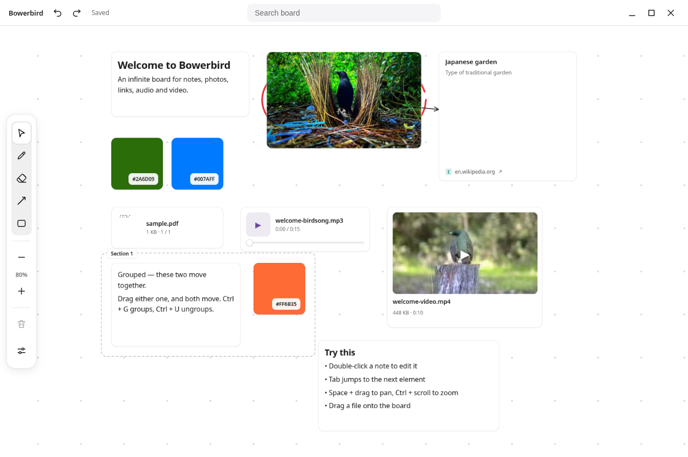

# Bowerbird

An infinite whiteboard for creatives. One window, always there, ready to drop things onto.

Drop images, notes, links, PDFs, audio, video and colours onto the board. Pan and zoom freely, sketch with a pen, connect things with lines, draw shapes, rotate cards and strokes, and group items that belong together. Drop a 3D model (`.glb`, `.obj`, `.fbx`, `.stl`, `.usdz` or `.dae`) and it lands as a model card you can drag to rotate; drop a Photoshop or Illustrator file and it lands as a design-file card with a preview of the artwork. The board saves on every change, and backs itself up at most once an hour.

Link cards are previews only. They do not embed web pages.

## What it looks like



The board. Notes, photos, links, audio, video and colour cards on an infinite canvas.


Draw with the pen.


Double-click anywhere to add notes.


Select cards, group them with Ctrl+G, and rename the group.


Space + drag to pan, = to zoom in — across a board full of cards.


Ctrl+K opens the command palette. It lists every action and jumps to any card.

## Run it

```sh
npm install
npm run dev
```

## Package it

```sh
./scripts/package-mac.sh      # macOS DMG
./scripts/package-win.sh      # Windows zip
./scripts/package-linux.sh    # Linux tarball
```

Or push a version tag (`v0.2.2`) and the release workflow builds all three and attaches them to a GitHub Release. The builds are unsigned, so a recipient must right-click the app and choose Open the first time (macOS) or accept the SmartScreen warning (Windows).

## Docs

- `PLUGIN_API.md` — how to write a plugin.
- `ARCHITECTURE.md` — core as API, all GUI as plugins.
- `plugins/README.md` — the bundled plugins.

## Layout

```
electron/          main process (TypeScript, compiled to electron-dist/)
src/               renderer: boot, backend, plugin host, UI
src/backend/       headless core (model, search, media, undo, drops, api, cards, model3d, poster, welcome, ai-import, audio-peaks, import-types, live-import, markdown, psd-import, svg-import)
src/plugins/       plugin host (host.ts plus host-cards, host-panels, host-state, host-views)
src/ui/            first-party UI plugins; the board is split six ways (board, board-input, board-render, board-state, board-geometry, board-drag-preview)
plugins/           bundled plugins
index.html         board shell
assets/            welcome media and icon
```

Checks:

```sh
npm run typecheck
npm run test:unit
npm run build
npm run test:e2e
```

## License

MIT.
